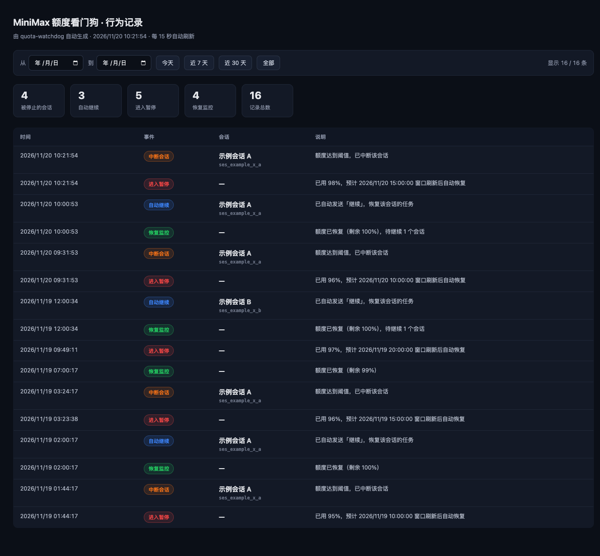

# opencode-minimax-subscription-watchdog

面向 **MiniMax 订阅（国内版）** 的 [OpenCode](https://opencode.ai) 插件：**实时监控 MiniMax 订阅额度**，在额度即将耗尽时自动暂停任务，到额度窗口重置后自动恢复并继续执行。

> 核心目标：保护你的 **MiniMax 订阅额度** 不被悄悄打满/超用，让长任务可以放心挂着跑——额度不够就停，窗口一刷新就自动接着干。

## ✨ 功能亮点

- **订阅额度实时监控**：直接查询 MiniMax 官方额度接口（国内版 `api.minimaxi.com`），按 5 小时 / 每周窗口计算已用与剩余。
- **自动暂停**：任一监控窗口已用达到阈值（默认 95%）时，中断活跃会话并拦截新的模型请求，避免继续消耗订阅额度。
- **额度耗尽兜底**：即使百分比接口滞后，只要模型返回 `429 / 额度不足` 也会立即暂停并记录待恢复会话（上游过载 `529/2064` 不会误判为额度不足）。
- **自动恢复与续跑**：到窗口重置时间后自动解除暂停，并**串行**向被中断的会话发送「继续」，从中断处接着完成任务（可关闭自动续跑）。
- **抗重启/抗重载**：活跃会话、待恢复队列与“待恢复清单”持久化；单实例租约避免插件重载后多实例互相覆盖状态，恢复链路更稳定。
- **任务队列**：把提示词投递到指定会话，串行自动执行；支持手动执行、定时自动执行、**闲时自动执行**（默认 22:00–05:00，支持跨 0 点）。
- **桌面端可视化**：侧栏「额度 · 任务队列」面板、输入框上方额度胶囊、**行为记录**页面（静态 HTML，可按日期筛选，记录中断/拦截/恢复/自动继续）。
- **只管 MiniMax 订阅模型**：默认只拦截/中断 `minimax-cn/*` 的会话与请求，其他模型（如 Claude、GPT、OpenCode 免费池等）不受影响。

## 界面预览

### 行为记录页面

记录每次进入暂停、中断会话、拦截请求、恢复监控与自动继续，支持按日期区间筛选、快捷时间范围和 15 秒自动刷新。



> 侧栏「额度 · 任务队列」面板与输入框上方的额度胶囊为 OpenCode 桌面端内嵌界面（实验性 GUI），启用插件后可在会话中直接使用。

## 工作原理

1. **实时查询**：调用 MiniMax 官方额度接口：
   - 国内版（默认）：`https://api.minimaxi.com/v1/token_plan/remains`
   - 国际版：`https://api.minimax.io/v1/api/openplatform/coding_plan/remains`
2. **凭据来源**：优先读取 OpenCode 中的 integration 凭据（默认 `minimax-cn`，即你在 OpenCode 登录的 MiniMax 国内版账号）；失败时回退到环境变量 `MINIMAX_API_KEY`。
3. **触发暂停**：任一监控窗口（5h / 每周）的已用百分比达到 `stopPercentUsed`（默认 95%）时：
   - 中断近期活跃会话（最近 10 分钟内有过模型调用的会话）；
   - 进入暂停态，新的 MiniMax 订阅模型请求会被拦截并提示预计恢复时间。
4. **额度错误兜底**：模型请求返回 `429 / 额度不足` 时，立即停止重试、记录会话并进入暂停态，确保被打断的会话一定会被续跑（上游过载 `529/2064`「负载较高/高峰」不触发暂停）。
5. **自动恢复**：到达窗口重置时间 + 缓冲（默认 60 秒）后重新查询：
   - 额度恢复 → 解除暂停，并按顺序给被停会话发送继续 prompt（`autoResume` 可关）；
   - 额度仍不足（如周窗口耗尽）→ 等待下一个重置点。
   - 恢复链持久化且抗重载；被停会话另写入只增不改的“待恢复清单”，并通过租约保证同一时刻只有一个实例轮询/写状态。

## 安装

> 前置：已安装并可正常使用 [OpenCode](https://opencode.ai) 桌面端/CLI，且已在 OpenCode 中配置 MiniMax 国内版订阅账号（`minimax-cn`）。

1. 克隆仓库：

```bash
git clone https://github.com/vee2046/opencode-minimax-subscription-watchdog.git
```

2. 在 OpenCode 配置中启用插件（全局 `~/.config/opencode/opencode.jsonc` 或项目 `opencode.json`）：

```jsonc
{
  "plugin": [
    // ...你现有的插件
    {
      "package": "/path/to/opencode-minimax-subscription-watchdog",
      "options": {}
    }
  ]
}
```

> 将路径替换为你本机的实际克隆路径。保存后 OpenCode 会热加载，无需重启。

3. （可选）确认凭据：默认使用 OpenCode 已登录的 `minimax-cn` 凭据；如需回退，可配置环境变量 `MINIMAX_API_KEY`。

## 配置项（options）

| 选项 | 默认值 | 说明 |
|---|---|---|
| `integrationID` | `"minimax-cn"` | 读取 MiniMax API Key 的 integration 凭据 ID |
| `endpoint` | `"auto"` | `"cn"` / `"international"` / `"auto"`（按 integrationID 是否含 `cn` 推断） |
| `stopPercentUsed` | `95` | 任一窗口已用达到该百分比时暂停 |
| `pollMs` | `60000` | 额度轮询间隔（毫秒） |
| `resumeBufferMs` | `60000` | 重置时间后的额外缓冲（毫秒） |
| `windows` | `["5h","weekly"]` | 监控的窗口 |
| `interruptWindowMs` | `600000` | 暂停时中断最近该时间内有模型调用的会话 |
| `autoResume` | `true` | 恢复后是否自动向被停会话发送继续 prompt |
| `resumeText` | 中文提示 | 自动恢复时发送的 prompt 文本 |
| `apiKeyEnv` | `"MINIMAX_API_KEY"` | 凭据不可用时的环境变量回退 |
| `timeoutMs` | `10000` | 额度接口请求超时（毫秒） |
| `modelFilter` | `["<integrationID>/*"]` | **模型过滤**（通配符，不区分大小写）。仅匹配的模型会被记录/拦截/中断，默认只管 MiniMax 订阅（`minimax-cn/*`） |
| `maxTaskMinutes` | `30` | 单任务最长执行时间，超时后中断并继续队列 |
| `dispatchIntervalMs` | `3000` | 队列调度检查间隔（毫秒） |
| `resumeTimeoutMs` | `180000` | 被停会话恢复后多久无响应则跳过（毫秒） |
| `pausedMarker` | `⛔` | 暂停时显示在胶囊/徽章上的标记 |
| `idleAutoExecute` | `true` | 是否启用闲时自动执行 |
| `idleStart` | `"22:00"` | 闲时区间开始（`HH:MM`，本地时间） |
| `idleEnd` | `"05:00"` | 闲时区间结束；开始 > 结束表示跨 0 点 |

## 任务队列

侧栏面板下半部分提供任务队列：把提示词投递到指定会话，按规则串行自动执行。

- **归属与权限**：任务绑定添加时的会话；面板可查看所有会话任务（当前会话置顶），仅所属会话可编辑/删除（前后端双重校验）。
- **串行与防重复**：全局同时只跑一个任务；任务在**派发瞬间**即标记已执行并落盘，避免重复执行。
- **额度联动**：额度不足时任务等待；恢复后先续跑被停会话，再派发队列任务。
- **闲时自动执行**：在设定时间区间内自动派发（默认 `22:00 → 05:00`，跨 0 点）；与手动“自动执行”开关为“或”关系。闲时只控制派发时机，额度闸门始终生效。
- **超时与持久化**：单任务超时会中断并记录错误后继续；任务持久化存储，重启不丢失。

## 桌面端可视化

- **侧栏面板**「额度 · 任务队列」：额度窗口进度/重置时间/模式状态 + 任务队列管理（添加、立即执行、自动执行与倒计时、闲时开关与区间等）。
- **额度胶囊**：输入框上方显示 `⚡ 剩余 X%`，颜色随余量变化，点击可查看详情。
- **📜 行为记录**：一键生成并打开静态 HTML 报告，展示中断会话、拦截请求、自动继续、进入暂停/恢复监控的时间线，支持按日期区间筛选与 15 秒自动刷新。

> GUI 使用 OpenCode 实验性接口（`./gui-experimental`），可能随版本变化；如有需要可在 **Settings > Extensions > Plugins** 中单独关闭 GUI。

## 命令

- `/watchdog-status` — 查看当前状态（模式、额度、预计恢复时间、已停会话数）
- `/watchdog-off` — 暂停监控并立即放行
- `/watchdog-on` — 重新开启监控
- `/tasks` — 列出任务队列
- `/task-add <提示词>` — 将提示词加入当前会话的待执行任务

## 数据与日志

- 诊断日志：`~/.local/share/opencode/quota-watchdog.log`
- 行为事件：`~/.local/share/opencode/quota-watchdog-events.jsonl`
- 行为记录页面：`~/.local/share/opencode/quota-watchdog-report.html`（也可通过侧栏按钮生成并打开）

## 注意事项

- `autoResume` 开启时，恢复会向被停会话发送一条真实的继续 prompt（会触发新的 agent 回合）；如需手动控制，可执行 `/watchdog-off` 或将 `autoResume` 设为 `false`。
- 暂停期间被拦截的请求出现插件错误提示是预期行为；普通聊天消息不会被静默排队，只有任务队列中的任务会等待派发。
- 默认仅作用于 **MiniMax 订阅模型**（`minimax-cn/*`），不会影响其他 provider / 免费池模型；如需扩大范围请配置 `modelFilter`。

## 开发

```bash
npm install
npm run typecheck   # 类型检查
npm run build       # 构建 GUI（输出 dist/gui-experimental.cjs）
```

源码结构：

- `src/index.ts` — 插件主体（轮询、状态机、hooks、命令、RPC、恢复链）
- `src/queue.ts` — 任务队列（入队/派发/串行/超时/权限）
- `src/minimax.ts` — MiniMax 额度客户端（请求/解析/评估）
- `src/rpc.ts` — RPC 契约
- `src/gui.tsx` — 桌面端 GUI（侧栏面板 + 胶囊）

## License

[MIT](./LICENSE)
